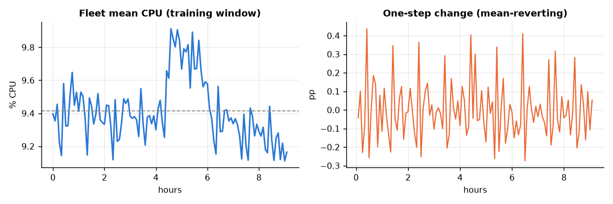
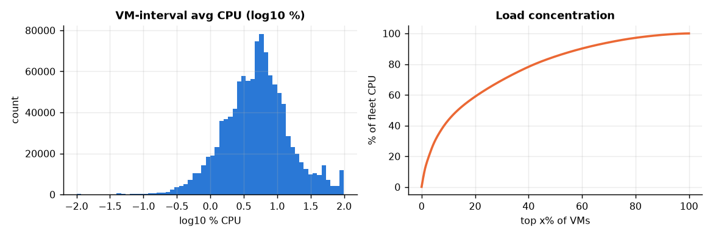
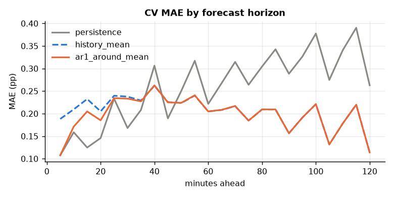
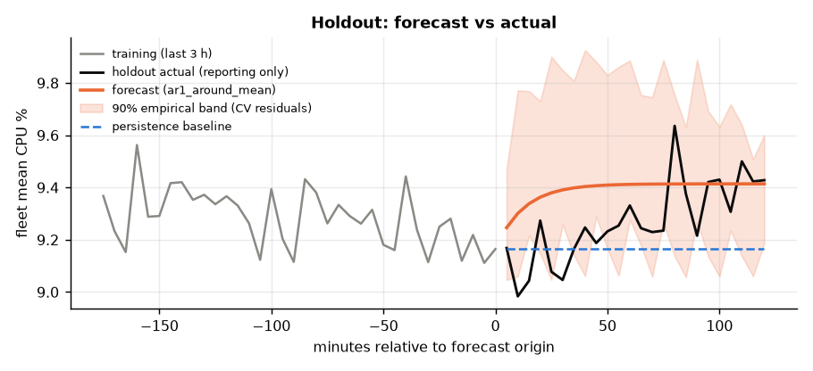

# Cloud Workload Forecasting — Final Report

*Azure Public Dataset V2, `data-v1` (10,000 VMs × 134 five-minute readings). Code: `src/cwfc`. All numbers below are produced by `python -m cwfc.predict` and `python -m cwfc.analysis` (tables in `reports/tables/`).*

## 1. Executive summary

**How predictable is the workload?** At fleet level it is highly *stable* but only weakly *predictable beyond its mean*. Mean CPU of the 10,000 VMs sits at 9.4 % with a coefficient of variation of 2.0 % over the 9.1 h training window; the series mean-reverts around a flat level (trend −0.013 pp/h, no hourly seasonality detectable in 11 h). Individual VMs, by contrast, are very noisy (median 5 %, p99 87 %), and the fleet-level wiggles come from a small, partly co-moving set of busy VMs.

**How accurately can near-term demand be forecast?** In rolling-origin validation (24-step horizon) the selected model — **AR(1) around the history mean** — reaches **MAE 0.198 pp / RMSE 0.237 pp** against **0.258 / 0.315** for persistence, i.e. **23 % lower MAE** (40 % in the later, more stable validation window). On the real 2-hour holdout the frozen forecast scored **MAE 0.153 pp, RMSE 0.183 pp** (≈1.7 % sMAPE) — *not* better than persistence on that single window (0.147 / 0.185); see §7 for why that is expected and not a reason to re-select.

**`active_vm_count`** is exactly 10,000 at every timestamp in this release (every selected VM has all 134 readings), so persistence is exact (MAE 0). This is a property of the sampling, not of cloud demand (§2).

**What should the team do?** Provision to *forecast + empirical headroom quantile*, and watch a peak-risk trigger (§8). In practice the useful headroom for the *fleet mean* is only ≈0.3–0.4 pp CPU; the real capacity risk is in the heavy-tailed VM distribution, which a fleet-mean forecast cannot see.

**Methodological headline:** a simple baseline-plus-statistics solution won; the VM-level gradient-boosting model was competitive on some windows but unstable across random seeds and lost overall, so it was not used. No model was selected on holdout data.

## 2. Data understanding and preprocessing

| Check | Result |
|---|---|
| Rows / VMs / timestamps | 1,340,000 / 10,000 / 134 (t = 0 … 39,900 s) |
| Cadence | all 133 gaps = 300 s; 0 missing grid points |
| Duplicates (vm, ts) | 0 |
| Nulls, non-finite, outside [0,100], avg outside [min,max] | 0 / 0 / 0 / 0 |
| Readings per VM | exactly 134 for every VM |
| Checksums | all three files `OK` |

**Target construction** (`cwfc.data.build_targets`): `active_vm_count(t)` = distinct VMs with a valid reading; `aggregate_cpu_utilization(t)` = mean of valid VM `avg_cpu` in percent. Handling rules, implemented and unit-tested even though this release triggers none: duplicate rows keep the first (VM counted once); non-finite or out-of-range readings become `NaN` (not zero); a timestamp with no readings yields `NaN` for CPU and 0 for the count; internal `NaN`s are linearly interpolated **only as model input**, never in the evaluation target. Cadence is kept at 5 minutes, so the mapping of forecasts to required timestamps is the identity.

**VM lifetimes and churn — an important caveat.** Every VM is created at t = 0 (before/at window start) and the earliest deletion is 40,500 s, *after* the last observation (39,900 s). The release only contains VMs that survived the whole window, so **there is no churn in the data** and `active_vm_count` is constant at 10,000. This is survivorship by construction (the sampler required complete 134-point traces), and it also means selection used future information about the VMs. Consequently the count forecast is trivially exact and says nothing about real-world scaling demand; I did not try to "make it interesting" with invented variation.

**Metadata used / not used.** Static, creation-time attributes (`vm_category`, `virtual_core_bucket`, `memory_gb_bucket`) are allowed as features. `avg_cpu`, `max_cpu`, `p95_max_cpu` in the metadata are lifetime statistics over the full 30-day trace (they include the holdout and the future) and `timestamp_vm_deleted` is a future event; all four are **excluded** as leakage. (They correlate 0.87 with training-window mean CPU, which is exactly why they would be tempting.)

## 3. Workload analysis

*Fleet level.* Mean 9.41 %, std 0.19 pp (range 9.11–9.91). The series is mean-reverting: lag-1 autocorrelation of the level is 0.67 but that of first differences is −0.42, the signature of noise around a slowly moving level rather than a random walk. A ~1.5-hour bump (≈+0.4 pp, hours 4.4–5.9) is the only visible regime movement; there is no recurring pattern at hourly period (seasonal-naive-12 is the worst model in CV) and nothing about daily seasonality can be learned from 11 hours.

*Distribution and concentration.* VM-interval utilisation is heavily right-skewed: median 5.1 %, p90 19.7 %, p99 87.4 %. The busiest 1 % of VMs carry 9.6 % of all CPU and the busiest 10 % carry 43.5 %. Operationally, the fleet is mostly idle with a small hot core.

*Statistical multiplexing.* Fleet-mean peak in the window is 9.9 % whereas the average VM peaks at 20.5 % (mean of `avg_cpu` maxima): the aggregate needs far less headroom than the sum of its parts, but only if VM peaks stay uncorrelated. They are not fully independent: the variance of fleet-level one-step changes is **10.8×** what independence would imply, and the 100 VMs with the largest co-movement (mostly 2-core, 60 % *Interactive*, mean 31 % CPU) contribute ≈31 % of the variance of fleet changes.

| Segment | VMs | Mean CPU % | Share of CPU | Series CV % |
|---|---:|---:|---:|---:|
| Delay-insensitive | 6,180 | 8.3 | 54.2 % | 2.6 |
| Interactive | 3,091 | 11.5 | 37.8 % | 2.1 |
| Unknown | 729 | 10.4 | 8.0 % | 6.0 |
| 2 cores | 7,534 | 9.8 | 78.1 % | 2.5 |
| 4 cores | 1,908 | 7.9 | 16.0 % | 2.3 |
| 8 cores | 486 | 9.7 | 5.0 % | 4.3 |
| 24 / >24 cores | 62 / 10 | 11.4 / 6.6 | 0.8 % / 0.07 % | 3.6 / 30 |

Segments move together (category-level change correlation 0.51–0.57), so there is no large diversification gain from separate segment models at this horizon; small segments (>24 cores, 10 VMs) are intrinsically noisy (CV 30 %) and are negligible for the fleet total. Peak (≥9.6 %) vs low-demand (≤9.2 %) periods differ by only ≈0.5 pp, so "peaks" in this window are small in absolute terms (see §8 for the operational reading).

## 4. Forecasting approach

Both targets are forecast directly at 5-minute resolution for h = 1…24.

*Baselines (required):* persistence, history mean, moving averages (6, 12), seasonal-naive (12 = one hour), simple exponential smoothing (α on a grid).
*Statistical:* **AR(1) around the history mean** — `ŷ(t+h) = μ + φ^h (y_t − μ)`, φ by OLS on the centred history, clipped to [0, 0.98]; a blend of AR(1) and SES.
*Bottom-up / ML (VM panel):* (i) per-VM AR(1) with shrunk φ, summed over VMs; (ii) a **global gradient-boosting model** (`HistGradientBoostingRegressor`) mapping VM features at an origin — last 3 values, 3/6/12-step means, own history mean/std/lag-1 ACF, last interval min/max, category, cores, memory, horizon — to `avg_cpu(t+h) − own history mean`, trained on all (origin, horizon) pairs whose targets lie inside the available history, then averaged across VMs; (iii) an equal-weight GBM+AR(1) hybrid.

*Information availability.* Every feature is computed from columns ≤ the forecast origin: the CV harness constructs a fresh truncated context per origin (`cwfc.evaluate.cross_validate`), and a unit test asserts forecasters never see past the origin. No calendar features are used: the window is 11 hours of a 30-day trace with unknown absolute clock, so time-of-day cannot be learned or validated.

*Why not a deep model?* 110 training points of a very smooth series cannot support one; the assignment explicitly does not reward it.

## 5. Validation methodology

*Holdout protocol.* The first 110 grid timestamps are the training window; the last 24 are the holdout. The holdout rows are dropped from the raw table before any value is read (`load_challenge`); a test (`tests/test_leakage.py`) rewrites the holdout CPU values (×4 and ×0.1) and asserts the predictions are **bit-identical**.

*Rolling-origin (expanding window) evaluation inside the training window.* Origins every 3 steps; each fits on `[0, o)` and forecasts `[o, o+24)`, never beyond step 110. This mirrors production: re-forecast periodically as new 5-minute data arrive with all history available. Two evaluation windows are scored — origins from 48 (13 folds) and from 60 (9 folds) — because with 110 points any single window is noisy.

*Pre-specified selection rule.* Choose the model minimising the **worst-case relative MAE** (MAE ÷ best MAE) across the two windows; ties go to the simpler model. This guards against picking a model that is lucky in one window (the assignment warns against single-metric cherry-picking). The rule is in code (`select_model`), executed before the holdout was ever opened.

*Caveat on validation size.* Windows overlap heavily (step 3 vs horizon 24), so folds are strongly dependent; 13 folds ≠ 13 independent samples. Differences of a few percent between the top models are not significant.

## 6. Results versus baseline

Rolling-origin CV, `aggregate_cpu_utilization`, MAE / RMSE in percentage points (pp); relative = MAE ÷ persistence MAE.

| Model | MAE (≥48) | RMSE (≥48) | Rel. | MAE (≥60) | Rel. | Worst-case regret |
|---|---:|---:|---:|---:|---:|---:|
| **AR(1) around mean (selected)** | **0.198** | **0.237** | **0.77** | **0.161** | **0.60** | **1.00** |
| Bottom-up AR(1) | 0.202 | 0.240 | 0.78 | 0.165 | 0.62 | 1.03 |
| History mean | 0.206 | 0.243 | 0.80 | 0.170 | 0.64 | 1.06 |
| AR(1) + SES blend | 0.210 | 0.251 | 0.82 | 0.184 | 0.69 | 1.15 |
| GBM + AR(1) hybrid | 0.216 | 0.252 | 0.84 | 0.184 | 0.69 | 1.14 |
| Panel GBM | 0.236 | 0.273 | 0.91 | 0.210 | 0.79 | 1.31 |
| SES | 0.250 | 0.302 | 0.97 | 0.237 | 0.89 | 1.48 |
| Moving average 6 | 0.250 | 0.300 | 0.97 | 0.239 | 0.90 | 1.49 |
| Persistence (baseline) | 0.258 | 0.315 | 1.00 | 0.266 | 1.00 | 1.66 |
| Moving average 12 | 0.270 | 0.313 | 1.05 | 0.263 | 0.99 | 1.64 |
| Seasonal naive (12) | 0.286 | 0.333 | 1.11 | 0.279 | 1.05 | 1.74 |

Take-aways. (1) Averaged over the 24-step horizon, anything that tracks the last value (persistence, short MAs, SES) is *worse* than predicting the mean — these series are noise around a level (but see the short-horizon caveat in §7). (2) The **panel GBM did not win**. Its CV MAE was 0.121 in one early experiment (min-train 60) but the same configuration with a different VM subsample seed gave 0.227 — a 2× swing — because a few hundred heavy-hitter VMs dominate the fleet mean and a random 3,000-VM subsample may or may not contain them. I replaced uniform subsampling with *all high-load VMs + inverse-probability-weighted sample of the rest*, which removed the luck factor but also the apparent edge (0.236/0.210). Reporting the first number would have been cherry-picking. (3) Feature-group ablations on the training window did not rescue it: dropping any single group changed CV MAE within the range seen across random seeds (0.20–0.24 at min-train 48), and no variant beat AR(1)'s 0.198.

## 7. Error and failure analysis

*Holdout (reported once, after freezing `predictions.csv`):*

| Target | Selected | MAE | RMSE | Persistence MAE / RMSE |
|---|---|---:|---:|---|
| `aggregate_cpu_utilization` | AR(1) around mean | 0.153 | 0.183 | 0.147 / 0.185 |
| `active_vm_count` | persistence | 0 | 0 | 0 / 0 |

*Honest reading.* The holdout fleet mean (9.27 %, range 8.98–9.64) ended close to the *last training value* (9.16 %), so persistence is nearly right by luck while the AR(1) forecast reverts toward the training mean 9.41 % and is biased +0.12 pp. Informational holdout scores of all candidates (`tables/holdout_all_models_informational.csv`) show a different order (AR(1)+SES blend best, 0.115; history mean worst, 0.175). I did **not** switch models after seeing this: the selection rule was fixed in advance, 24 strongly autocorrelated points give an extremely noisy ranking, and re-selecting on holdout is exactly what the protocol forbids. Over the full CV the selected model is 23–40 % better than persistence; on the one real holdout it is 4 % worse.

*Where it fails and why.*
* **Level shifts.** The training window contains a +0.4 pp regime (hours 4.4–5.9). A mean-reverting model treats it as noise: on top-quartile-load CV windows its MAE rises to **0.284** (vs 0.160 on other windows) with a bias of **−0.25 pp (under-forecast)**. Persistence, which tracks level, does better at peaks (0.238) and worse elsewhere (0.266). Operationally this is the dangerous direction: **mean-reverting forecasts under-predict sustained peaks**.
* **Short horizon.** Persistence is as good or better up to ≈30 minutes ahead (CV MAE at 15 min: 0.125 vs 0.205 for AR(1)); AR(1) is consistently better only from ≈50 minutes, and by 2 hours it is far better (0.114 vs 0.263). The selected model therefore gives up accuracy at short horizons; a production system should blend by horizon (not implemented or validated here).
* **Noise floor.** One-step fleet change has std 0.158 pp; no model can beat this at h = 1 without VM-level information that is not predictive here.
* **Percentage metrics:** sMAPE (denominator floored at 1e-8) is reported only as a secondary metric; with a fleet mean near 9.4 % there is no near-zero denominator problem, and for `active_vm_count` the error is exactly 0.
* **Hidden-VM limits.** Individual VMs have median lag-1 ACF 0.06; VM-level forecasts are close to hopeless, and the aggregate is predictable only because noise averages out.

## 8. Capacity-planning recommendation

**Policy (simple, auditable):**
1. **Forecast** the fleet-mean CPU with AR(1) (refit every 5 minutes on all history).
2. **Provision** capacity for `forecast + headroom`, where headroom is the *q-quantile of backtest residuals per horizon* (empirical, no distribution assumption). Backtest on training-window origins:

| Headroom quantile | Share of forecast-steps under-provisioned | Mean spare capacity (pp of fleet CPU) |
|---:|---:|---:|
| 0.50 | 49 % | 0.07 |
| 0.80 | 24 % | 0.24 |
| 0.90 | 17 % | 0.33 |
| 0.95 | 13 % | 0.36 |
| 0.99 | 10 % | 0.39 |

   The 90 % band is ≈0.6 pp wide (shown in the holdout figure). On the holdout it covered 75 % of points (nominal 90 %) with 0 points above the upper bound and none above forecast+0.22 pp: under-coverage came from points *below* the band, which only costs spare capacity.
3. **Peak-risk trigger (to cover the failure mode above):** if the 3-step moving average exceeds the history mean by more than ≈0.25 pp (about one CV RMSE) for ≥ 3 consecutive intervals — an illustrative threshold I did not backtest —, treat it as a level shift: switch to a level-following forecast (persistence/SES) and hold headroom at the 0.95 quantile until the signal clears.
4. **Segment rule:** protect *Interactive* VMs (higher mean CPU, 38 % of load, 60 % of the top co-moving VMs) with the higher quantile; let *Delay-insensitive* workloads absorb the slack (they are 54 % of load and tolerate delay by definition).

**Trade-off.** Because the fleet mean is so smooth, the *over*-provisioning cost of a 0.95 headroom is tiny (≈0.36 pp of fleet CPU) while a single missed sustained peak can be worse; choose a high quantile for latency-sensitive tiers and a median-to-0.8 quantile for batch tiers. The violation rate does not fall below ≈10 % even at q = 0.99 because the backtest windows contain the level-shift regime that residuals from other windows do not cover — more history is the fix, not a wider band. **Fleet-mean forecasts do not size individual hosts**: the average VM peaks at ~20 % while the fleet mean peaks at ~10 %; per-host placement needs VM-level risk, which this forecast does not provide.

## 9. Limitations and future work

* **Only 9.1 h of training history** (110 points): no daily/weekly seasonality can be learned and a regime change is indistinguishable from noise. The conclusions about "predictability" are conditional on this window.
* **No churn** (survivorship, §2): `active_vm_count` is trivially constant and VM arrival/departure risk — the real scaling driver — is unobservable.
* **Single holdout window, 24 dependent points**: the holdout ranking of models is not statistically meaningful; CV windows overlap heavily; the uncertainty band (empirical CV residuals) is approximate and under-covered on the holdout.
* **Not done:** optional segment-level forecasting (segments move together, little expected gain), conformal/quantile-regression intervals, anomaly detection, Google ClusterData2019 comparison. With more data I would (i) add time-of-day/week features, (ii) model churn explicitly (survival model on VM lifetimes), (iii) forecast the *tail* (e.g. p95 across VMs, or cores-weighted demand), which matters more for capacity than the mean, (iv) calibrate intervals with conformal methods across many more origins.
* **Dependencies:** numpy, pandas, scikit-learn (matplotlib for figures only). Source: Microsoft Azure Public Dataset V2.

## Appendix — reproducibility

`python -m cwfc.predict --data challenge_data --output predictions.csv` (≈1.5 min, 2 cores) → `predictions.csv`;
`python -m cwfc.analysis` → tables/figures; `pytest -q` → 15 tests. Seeds are fixed (`panel_gbm(seed=0)`); CV selection table: `reports/tables/model_selection.json`.
